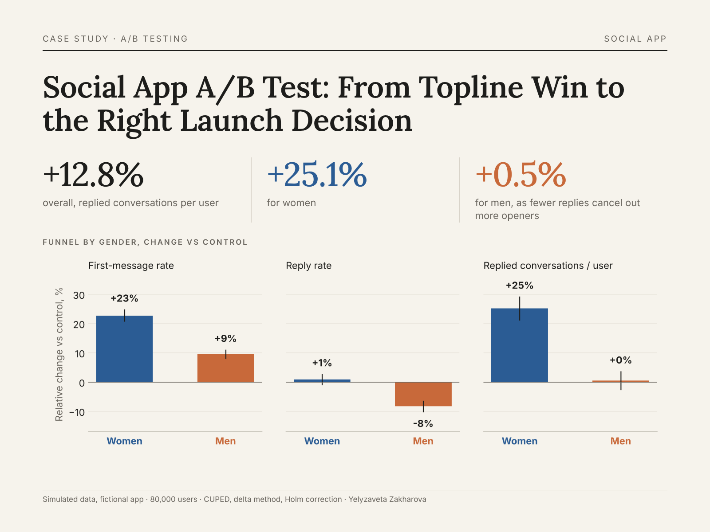

# Social App A/B Test: From Topline Win to the Right Launch Decision



**A/B testing** · Python · [Read the case study (PDF)](report.pdf) · [Open the notebook](ab_test_conversation_starters.ipynb)

## TL;DR
A “Conversation Starters” feature won its A/B test overall (+12.8%), but the lift came entirely from women. Men sent more openers and got fewer replies, and part of the women's effect was novelty. Decision: ship for women with a holdout, redesign for men.

## Key results
| | |
|---|---|
| **+12.8%** | replied conversations per user, overall |
| **+25.1%** | for women |
| **+0.5%** | for men (not significant): −8% reply rate cancels out more openers |
| **~+15%** | lasting effect for women once novelty fades, vs +25% over 7 days |

## Methods
SRM and balance checks · power / MDE · Welch t-test · delta method for ratio metrics · CUPED · Holm correction · interaction test · novelty analysis

## What's inside
| File | What it is |
|---|---|
| [`report.pdf`](report.pdf) | The case study: problem, approach, findings, recommendation |
| [`ab_test_conversation_starters.ipynb`](ab_test_conversation_starters.ipynb) | Full analysis with outputs |
| `generate_data.py` | Data simulation (fixed seed, reproducible) |
| `data/` | `users.csv.gz` (80K users, per-user 7-day metrics), `daily_activity.csv.gz` (user × day) |
| `charts/` | Charts used in the report |

## Run it
```bash
pip install -r ../requirements.txt
jupyter notebook ab_test_conversation_starters.ipynb
```

> **Data note:** all data is simulated for a fictional company. No real company or user data is used.

[← Back to portfolio](../README.md)
