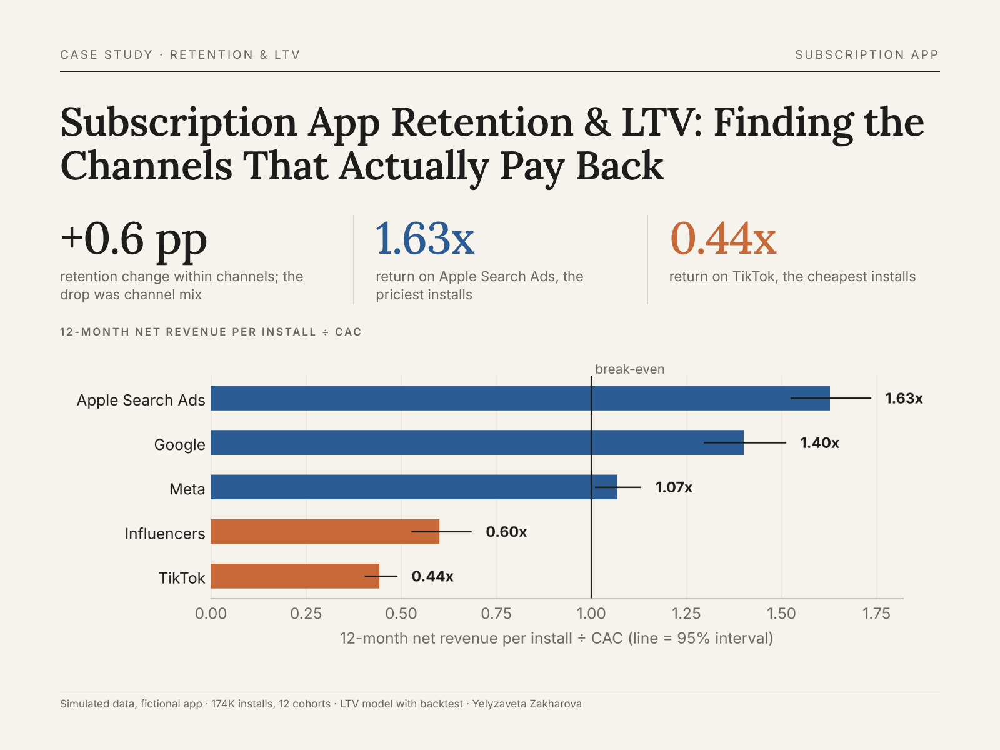

# Subscription App Retention & LTV: Finding the Channels That Actually Pay Back



**Retention & LTV** · SQL · Python · [Read the case study (PDF)](report.pdf) · [Open the notebook](retention_ltv_by_channel.ipynb) · [SQL queries](queries.sql)

## TL;DR
Retention was falling while the team scaled its cheapest channel. Cohort analysis showed retention within every channel was flat: the drop was channel mix. An LTV model, backtested to 4% error, showed TikTok returning 0.44x its cost and Apple Search Ads 1.63x.

## Key results
| | |
|---|---|
| **+0.6 pp** | D30 retention change within channels (overall −3.4 pp is mix) |
| **1.63x** | 12-month LTV / CAC, Apple Search Ads |
| **0.44x** | TikTok, the cheapest installs |
| **4%** | LTV forecast error in an out-of-time backtest |

## Methods
Cohort analysis with censoring-aware retention · mix vs within-channel decomposition · renewal-based LTV model · out-of-time backtest · Bayesian bootstrap · payback curves · budget scenario

## What's inside
| File | What it is |
|---|---|
| [`report.pdf`](report.pdf) | The case study: problem, approach, findings, recommendation |
| [`retention_ltv_by_channel.ipynb`](retention_ltv_by_channel.ipynb) | Full analysis with outputs |
| [`queries.sql`](queries.sql) | The core analysis in SQL: retention by channel, mix decomposition, monetization drivers, LTV/CAC and payback, cohort revenue matrix |
| `run_sql.py` | Runs all queries locally with DuckDB |
| `generate_data.py` | Data simulation (fixed seed, reproducible) |
| `data/` | `users.csv.gz` (174K installs), `transactions.csv` (subscription charges), `marketing_spend.csv` |
| `charts/` | Charts used in the report |

## Run it
```bash
pip install -r ../requirements.txt
jupyter notebook retention_ltv_by_channel.ipynb   # Python version
python run_sql.py                                  # SQL version (DuckDB), same numbers
```

> **Data note:** all data is simulated for a fictional company. No real company or user data is used.

[← Back to portfolio](../README.md)
