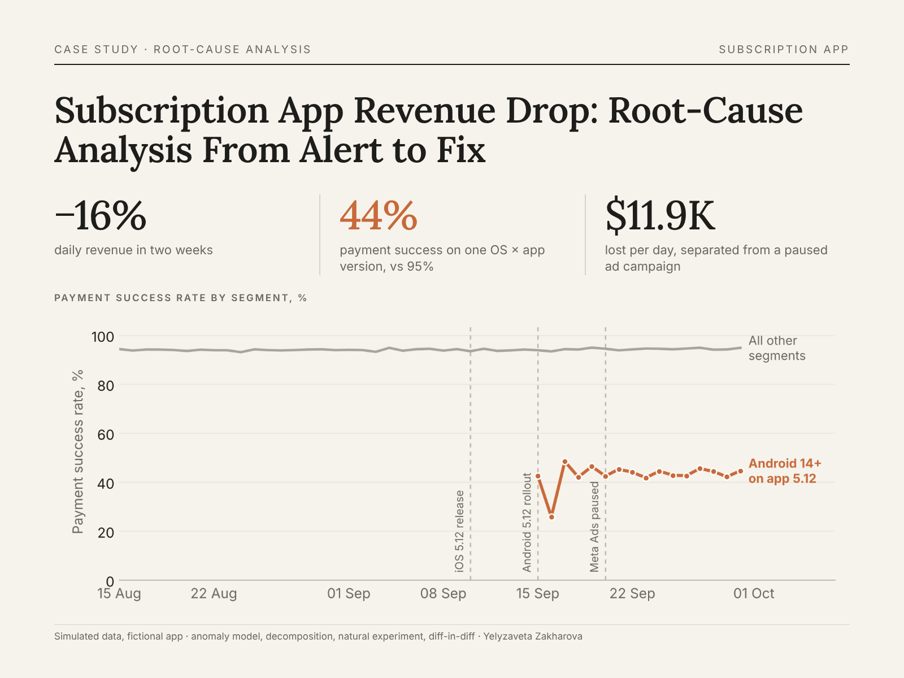

# Subscription App Revenue Drop: Root-Cause Analysis From Alert to Fix



**KPI diagnostics** · Python · [Read the case study (PDF)](report.pdf) · [Open the notebook](revenue_drop_diagnosis.ipynb)

## TL;DR
Revenue fell 16% in two weeks while two app releases and a paused ad campaign landed in the same window. Decomposition and a drill-down isolated a payment bug in one OS × app version, confirmed by the staged rollout as a natural experiment, and separated it from the ad pause.

## Key results
| | |
|---|---|
| **−16%** | daily revenue in two weeks |
| **44%** | payment success in the affected segment, vs 95% |
| **$11.9K/day** | lost to the bug, 77% of the drop |
| **$4.9K/day** | from the ad pause, sized separately |

## Methods
Anomaly detection (trend + seasonality, prediction intervals) · revenue decomposition · mix-adjusted drill-down · funnel vs same-day controls · natural experiment · difference-in-differences

## What's inside
| File | What it is |
|---|---|
| [`report.pdf`](report.pdf) | The case study: problem, approach, findings, recommendation |
| [`revenue_drop_diagnosis.ipynb`](revenue_drop_diagnosis.ipynb) | Full analysis with outputs |
| `generate_data.py` | Data simulation (fixed seed, reproducible) |
| `data/` | `daily_segments.csv` (daily funnel by platform × version × OS × user type × country), `installs_by_channel.csv` |
| `charts/` | Charts used in the report |

## Run it
```bash
pip install -r ../requirements.txt
jupyter notebook revenue_drop_diagnosis.ipynb
```

> **Data note:** all data is simulated for a fictional company. No real company or user data is used.

[← Back to portfolio](../README.md)
