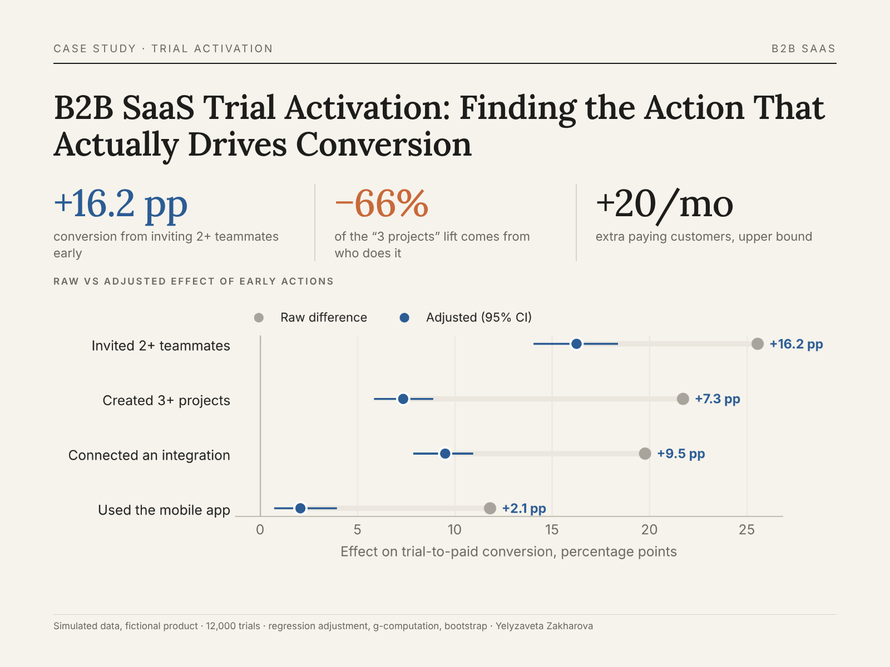

# B2B SaaS Trial Activation: Finding the Action That Actually Drives Conversion



**Activation · causal inference** · Python · [Read the case study (PDF)](report.pdf) · [Open the notebook](trial_activation.ipynb)

## TL;DR
Onboarding pushed new teams to create three projects. Adjusting for team size and intent showed most of that lift was motivation; inviting 2+ teammates in the first three days is the action that matters. Validation against simulated ground truth shows why the next step is an A/B test.

## Key results
| | |
|---|---|
| **+16.2 pp** | adjusted effect of inviting 2+ teammates early |
| **−66%** | of the “3 projects” lift comes from who does it |
| **3.5x** | conversion for teams that invite in days 0–2 vs later |
| **+20/mo** | extra customers from a new onboarding step (upper bound) |

## Methods
Early-window features · regression adjustment with intent proxies · g-computation · bootstrap CIs · dose-response threshold · timing analysis · opportunity sizing · validation vs ground truth

## What's inside
| File | What it is |
|---|---|
| [`report.pdf`](report.pdf) | The case study: problem, approach, findings, recommendation |
| [`trial_activation.ipynb`](trial_activation.ipynb) | Full analysis with outputs |
| `generate_data.py` | Data simulation (fixed seed, reproducible) |
| `data/` | `trials.csv` (12K trials: firmographics, signup signals, actions in days 0–2, conversion, MRR) |
| `charts/` | Charts used in the report |

## Run it
```bash
pip install -r ../requirements.txt
jupyter notebook trial_activation.ipynb
```

> **Data note:** all data is simulated for a fictional company. No real company or user data is used.

[← Back to portfolio](../README.md)
