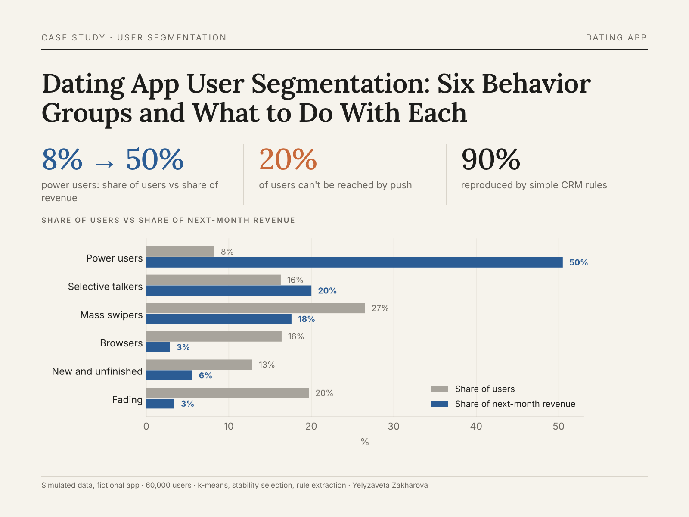

# Dating App User Segmentation: Six Behavior Groups and What to Do With Each



**Segmentation** · Python · [Read the case study (PDF)](report.pdf) · [Open the notebook](user_segmentation.ipynb)

## TL;DR
Behavioral clustering of 60K users found six segments that differ sharply in future retention and revenue, which they were not built on. Simple rules reproduce the segments for 90% of users, so CRM can use them without a model.

## Key results
| | |
|---|---|
| **8% → 50%** | power users: share of users vs share of revenue |
| **20%** | of users are fading with push off: e-mail is the only channel |
| **31–86%** | next-month retention across segments |
| **90%** | agreement between the model and 7 simple CRM rules |

## Methods
Feature engineering · k-means with silhouette + bootstrap-stability selection · z-score profiling · validation on future outcomes · decision-tree rule extraction

## What's inside
| File | What it is |
|---|---|
| [`report.pdf`](report.pdf) | The case study: problem, approach, findings, recommendation |
| [`user_segmentation.ipynb`](user_segmentation.ipynb) | Full analysis with outputs |
| `generate_data.py` | Data simulation (fixed seed, reproducible) |
| `data/` | `users.csv.gz` (60K users: 30-day behavior + next-30-day outcomes) |
| `charts/` | Charts used in the report |

## Run it
```bash
pip install -r ../requirements.txt
jupyter notebook user_segmentation.ipynb
```

> **Data note:** all data is simulated for a fictional company. No real company or user data is used.

[← Back to portfolio](../README.md)
