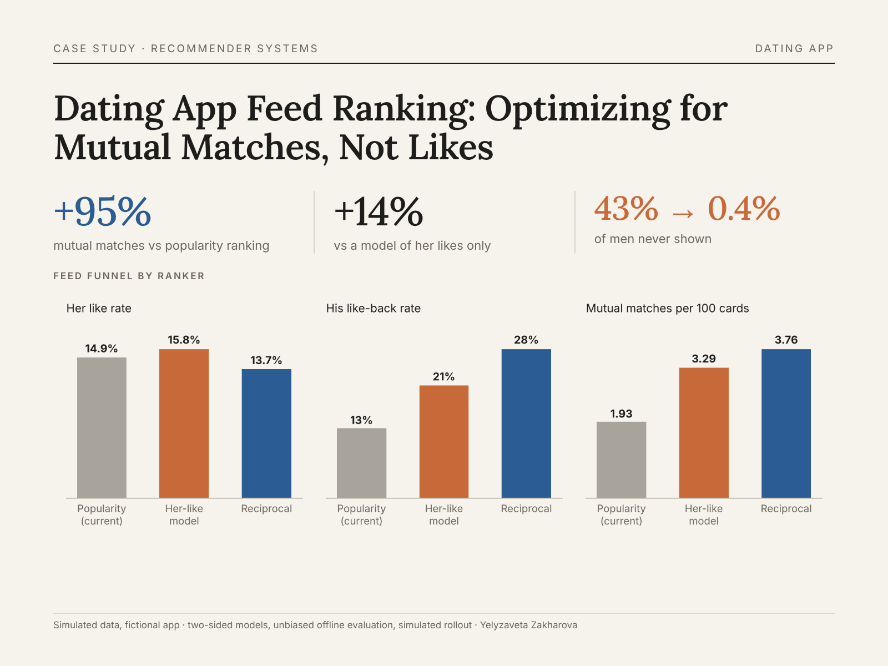

# Dating App Feed Ranking: Optimizing for Mutual Matches, Not Likes



**Recommender systems** · Python · [Read the case study (PDF)](report.pdf) · [Open the notebook](reciprocal_ranking.ipynb)

## TL;DR
A popularity-ranked feed sends women's likes to men who rarely answer. Two-sided models ranking by the chance of a mutual match nearly doubled matches in a simulated rollout and showed almost every profile, while offline evaluation on random exploration slots showed what offline metrics can and can't tell.

## Key results
| | |
|---|---|
| **+95%** | mutual matches vs popularity ranking |
| **+14%** | vs a model of her likes only |
| **43% → 0.4%** | of men never shown in a week |
| **0.25** | exposure Gini, down from 0.52 |

## Methods
Two-sided logistic models · offline evaluation on random exploration slots (NDCG@5, AUC, bootstrap) · agent-based simulated rollout · exposure Gini and Lorenz curves

## What's inside
| File | What it is |
|---|---|
| [`report.pdf`](report.pdf) | The case study: problem, approach, findings, recommendation |
| [`reciprocal_ranking.ipynb`](reciprocal_ranking.ipynb) | Full analysis with outputs |
| `generate_data.py` | Data simulation (fixed seed, reproducible) |
| `data/` | `impressions.csv.gz` (875K logged impressions), `women.csv`, `men.csv`; `sim.py` is the simulator |
| `charts/` | Charts used in the report |

## Run it
```bash
pip install -r ../requirements.txt
jupyter notebook reciprocal_ranking.ipynb
```

> **Data note:** all data is simulated for a fictional company. No real company or user data is used.

[← Back to portfolio](../README.md)
