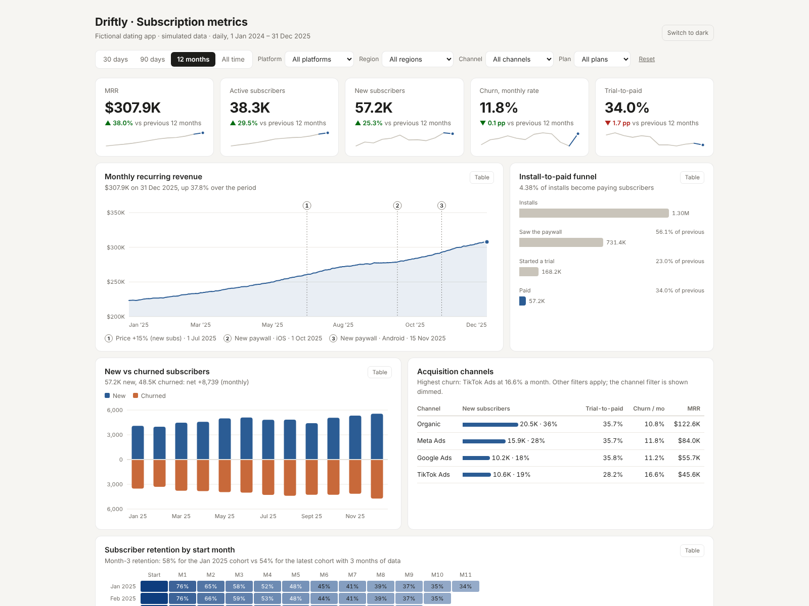

# Subscription Metrics Dashboard (interactive)

**Data visualization** · HTML, SVG, JavaScript (no libraries) · **[Open the live dashboard](https://y-zakharova.github.io/analytics-portfolio/07-subscription-dashboard/)**

## What it is
A daily metrics dashboard for the founders and growth team of a subscription app: how revenue is growing,
where subscribers come from, how many leave, and whether recent product changes worked.

## What you can do
- **Filter** everything at once by period (30 days, 90 days, 12 months, all time), platform, region, channel and plan.
- **Compare** every KPI with the previous period of the same length.
- **Hover** any chart for exact values; switch any chart to a **table view**.
- **Read the story:** product events (a price change and a new paywall) are marked on the MRR chart.
- Light and dark mode.

## What's on it
| Block | Question it answers |
|---|---|
| KPI tiles: MRR, active subscribers, new subscribers, monthly churn, trial-to-paid | Are we growing, and is it healthy? |
| MRR over time with event markers | What moved revenue, and when? |
| Install-to-paid funnel | Where do potential subscribers drop off? |
| New vs churned subscribers | Is growth coming from acquisition or retention? |
| Acquisition channels | Which channels bring subscribers who stay and pay? |
| Retention by start month (cohort heatmap) | Are newer cohorts retaining better or worse? |

## Things the data shows
- MRR grew 38% in 2025, but trial-to-paid dropped 1.7 pp after the July price increase.
- TikTok Ads brings 19% of new subscribers but churns 16.6% a month, against 10.8% for organic.
- MRR growth slowed to 0.8% in September. After the new paywall (iOS in October, Android in November), trial starts per install rose from 12.4% to 14.4% and monthly MRR growth went back to 3–4%.

## Files
| File | What it is |
|---|---|
| `index.html` | The dashboard: one self-contained file, data included |
| `template.html` | Dashboard code without data |
| `generate_data.py` | Simulates the subscription data (fixed seed) |
| `build_html.py` | Embeds the data into the template |
| `data/` | `dashboard_data.json` (aggregated daily data), `daily_totals.csv` (totals for checking) |

Rebuild: `python generate_data.py && python build_html.py`

> **Data note:** all data is simulated for a fictional app. No real company or user data is used.

[← Back to portfolio](../README.md)
