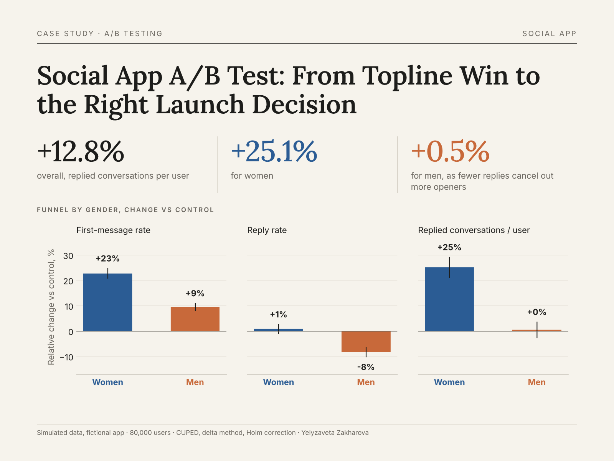
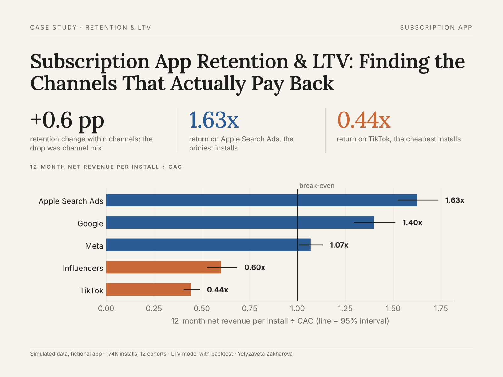
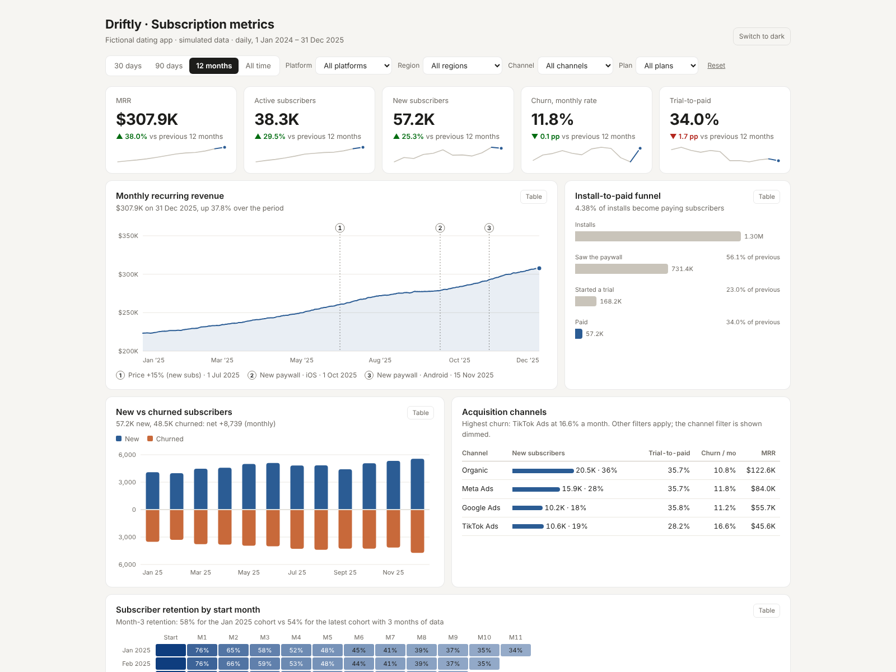
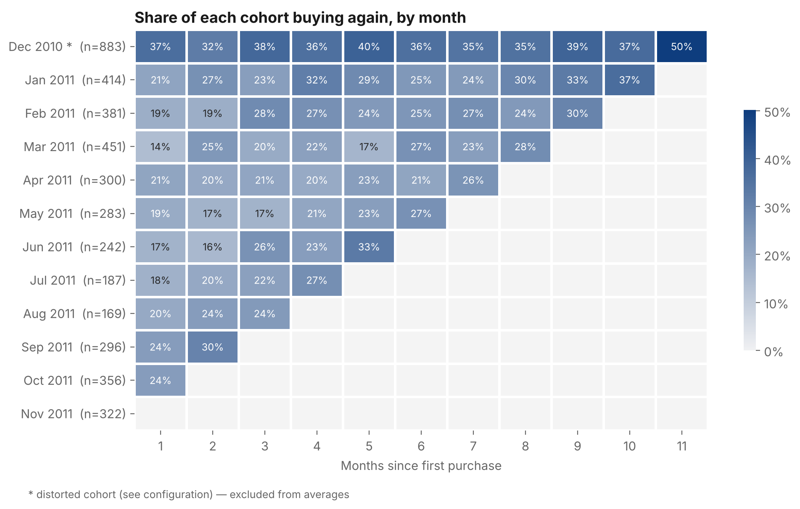

# Product Analytics Portfolio

**Yelyzaveta Zakharova** · Product Analyst

I help subscription and consumer apps make product decisions with data: designing and reading A/B tests, finding why a metric moved,
measuring retention and LTV, and turning analysis into a clear recommendation the team can act on.

**What I do:** A/B testing · KPI root-cause analysis · retention & LTV · user segmentation · activation and funnels · dashboards

**Tools:** SQL (ClickHouse) · Python (pandas, statsmodels, scikit-learn) · Tableau · Jupyter

## Case studies

<table>
<tr><td width="50%" valign="top"><a href="01-ab-test-social-app/"></a><br><b><a href="01-ab-test-social-app/">A/B test: from topline win to the right launch decision</a></b><br><sub>A/B testing · +12.8% replied conversations per user, overall</sub></td><td width="50%" valign="top"><a href="02-retention-ltv-by-channel/"></a><br><b><a href="02-retention-ltv-by-channel/">Retention & LTV: which acquisition channels pay back</a></b><br><sub>Retention & LTV · +0.6 pp D30 retention change within channels (overall −3.4 pp is mix)</sub></td></tr>
<tr><td width="50%" valign="top"><a href="03-revenue-drop-root-cause/"></a><br><b><a href="03-revenue-drop-root-cause/">Revenue drop: root-cause analysis from alert to fix</a></b><br><sub>KPI diagnostics · −16% daily revenue in two weeks</sub></td><td width="50%" valign="top"><a href="04-saas-trial-activation/"></a><br><b><a href="04-saas-trial-activation/">B2B SaaS: the action that actually drives trial conversion</a></b><br><sub>Activation · causal inference · +16.2 pp adjusted effect of inviting 2+ teammates early</sub></td></tr>
<tr><td width="50%" valign="top"><a href="05-user-segmentation/"></a><br><b><a href="05-user-segmentation/">User segmentation: six behavior groups and a playbook for each</a></b><br><sub>Segmentation · 8% → 50% power users: share of users vs share of revenue</sub></td><td width="50%" valign="top"><a href="07-subscription-dashboard/"></a><br><b><a href="07-subscription-dashboard/">Interactive subscription metrics dashboard</a></b> · <a href="https://y-zakharova.github.io/analytics-portfolio/07-subscription-dashboard/">live demo</a><br><sub>Data visualization · MRR, churn, funnel, channels and cohorts with filters</sub></td></tr>
<tr><td width="50%" valign="top"><a href="ecommerce-cohort-retention/"></a><br><b><a href="ecommerce-cohort-retention/">E-commerce cohort & repeat-purchase analysis (real data)</a></b><br><sub>Retention & cohorts · 44% of customers never buy a second time; the window for a second order is days 30–90</sub></td><td width="50%"></td></tr>
</table>

| # | Case study | Area | Headline |
|---|---|---|---|
| 1 | [Social App A/B Test: From Topline Win to the Right Launch Decision](01-ab-test-social-app/) | A/B testing | +12.8% replied conversations per user, overall |
| 2 | [Subscription App Retention & LTV: Finding the Channels That Actually Pay Back](02-retention-ltv-by-channel/) | Retention & LTV | +0.6 pp D30 retention change within channels (overall −3.4 pp is mix) |
| 3 | [Subscription App Revenue Drop: Root-Cause Analysis From Alert to Fix](03-revenue-drop-root-cause/) | KPI diagnostics | −16% daily revenue in two weeks |
| 4 | [B2B SaaS Trial Activation: Finding the Action That Actually Drives Conversion](04-saas-trial-activation/) | Activation · causal inference | +16.2 pp adjusted effect of inviting 2+ teammates early |
| 5 | [Social App User Segmentation: Six Behavior Groups and What to Do With Each](05-user-segmentation/) | Segmentation | 8% → 50% power users: share of users vs share of revenue |
| 6 | [Subscription Metrics Dashboard (interactive)](07-subscription-dashboard/) · [live demo](https://y-zakharova.github.io/analytics-portfolio/07-subscription-dashboard/) | Data visualization | MRR, churn, funnel, channels and cohorts with filters |
| 7 | [E-commerce Cohort & Repeat-Purchase Analysis](ecommerce-cohort-retention/) · real public data | Retention & cohorts | 44% never buy again; second-order window is days 30–90 |

Cases 1–5 each have a short PDF report, a notebook with the full analysis, the data and the code that generates it. Case 6 is an interactive dashboard you can open in the browser. Case 7 is built on real public data and can be rerun on a store's own order exports.

## How to run
```bash
git clone https://github.com/y-zakharova/analytics-portfolio.git
cd analytics-portfolio
pip install -r requirements.txt
jupyter notebook
```

> **Data note:** cases 1–6 use simulated data for fictional companies; case 7 uses the public UCI Online Retail dataset. No confidential company or user data is used. The cases mirror problems I work on, rebuilt from scratch on synthetic data so the methods and reasoning can be shown in full.

## Contact
Upwork: [add your profile link](https://www.upwork.com/freelancers/~01e9f12bceefc5eaee) · LinkedIn: [add your profile link](https://www.linkedin.com/in/yelyzaveta-zakharova/)
