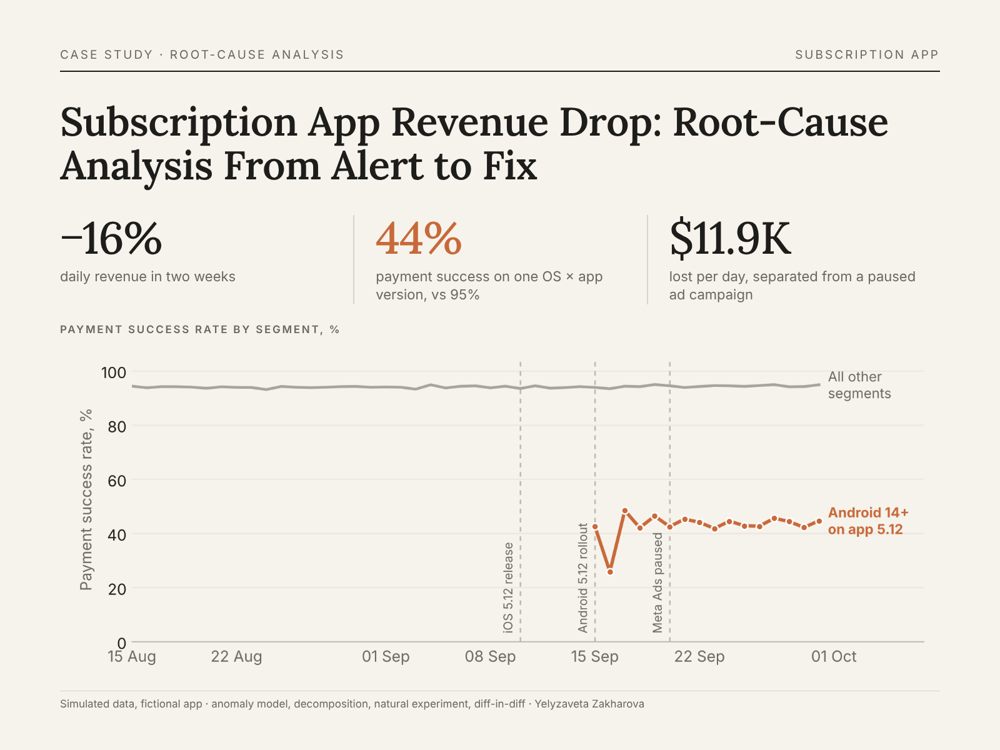
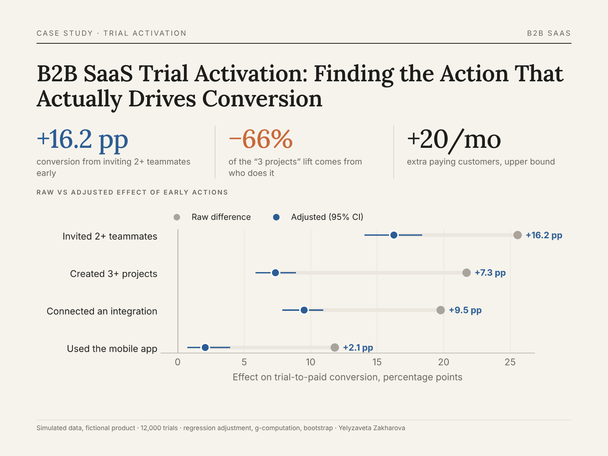
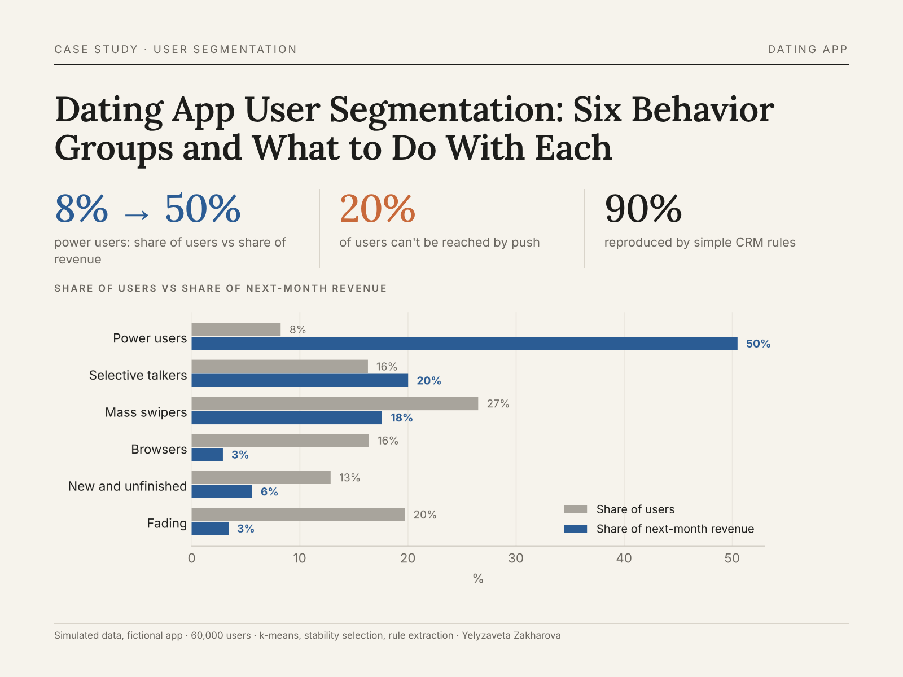

# Product Analytics Portfolio

**Yelyzaveta Zakharova** · Product Analyst

I help subscription and consumer apps make product decisions with data: designing and reading A/B tests, finding why a metric moved,
measuring retention and LTV, and turning analysis into a clear recommendation the team can act on.

**What I do:** A/B testing · KPI root-cause analysis · retention & LTV · user segmentation · activation and funnels · recommender evaluation

**Tools:** SQL (ClickHouse) · Python (pandas, statsmodels, scikit-learn) · Tableau · Jupyter

## Case studies

<table>
<tr><td width="50%" valign="top"><a href="01-ab-test-dating-app/"></a><br><b><a href="01-ab-test-dating-app/">A/B test: from topline win to the right launch decision</a></b><br><sub>A/B testing · +12.8% replied conversations per user, overall</sub></td><td width="50%" valign="top"><a href="02-retention-ltv-by-channel/"></a><br><b><a href="02-retention-ltv-by-channel/">Retention & LTV: which acquisition channels pay back</a></b><br><sub>Retention & LTV · +0.6 pp D30 retention change within channels (overall −3.4 pp is mix)</sub></td></tr>
<tr><td width="50%" valign="top"><a href="03-revenue-drop-root-cause/"></a><br><b><a href="03-revenue-drop-root-cause/">Revenue drop: root-cause analysis from alert to fix</a></b><br><sub>KPI diagnostics · −16% daily revenue in two weeks</sub></td><td width="50%" valign="top"><a href="04-saas-trial-activation/"></a><br><b><a href="04-saas-trial-activation/">B2B SaaS: the action that actually drives trial conversion</a></b><br><sub>Activation · causal inference · +16.2 pp adjusted effect of inviting 2+ teammates early</sub></td></tr>
<tr><td width="50%" valign="top"><a href="05-user-segmentation/"></a><br><b><a href="05-user-segmentation/">User segmentation: six behavior groups and a playbook for each</a></b><br><sub>Segmentation · 8% → 50% power users: share of users vs share of revenue</sub></td><td width="50%" valign="top"><a href="06-feed-ranking-recsys/"></a><br><b><a href="06-feed-ranking-recsys/">Feed ranking: optimizing for mutual matches, not likes</a></b><br><sub>Recommender systems · +95% mutual matches vs popularity ranking</sub></td></tr>
</table>

| # | Case study | Area | Headline |
|---|---|---|---|
| 1 | [Dating App A/B Test: From Topline Win to the Right Launch Decision](01-ab-test-dating-app/) | A/B testing | +12.8% replied conversations per user, overall |
| 2 | [Subscription App Retention & LTV: Finding the Channels That Actually Pay Back](02-retention-ltv-by-channel/) | Retention & LTV | +0.6 pp D30 retention change within channels (overall −3.4 pp is mix) |
| 3 | [Subscription App Revenue Drop: Root-Cause Analysis From Alert to Fix](03-revenue-drop-root-cause/) | KPI diagnostics | −16% daily revenue in two weeks |
| 4 | [B2B SaaS Trial Activation: Finding the Action That Actually Drives Conversion](04-saas-trial-activation/) | Activation · causal inference | +16.2 pp adjusted effect of inviting 2+ teammates early |
| 5 | [Dating App User Segmentation: Six Behavior Groups and What to Do With Each](05-user-segmentation/) | Segmentation | 8% → 50% power users: share of users vs share of revenue |
| 6 | [Dating App Feed Ranking: Optimizing for Mutual Matches, Not Likes](06-feed-ranking-recsys/) | Recommender systems | +95% mutual matches vs popularity ranking |

Each case has a short PDF report, a notebook with the full analysis, the data and the code that generates it.

## How to run
```bash
git clone https://github.com/y-zakharova/analytics-portfolio.git
cd analytics-portfolio
pip install -r requirements.txt
jupyter notebook
```

> **Data note:** all data is simulated for a fictional company. No real company or user data is used. The cases mirror problems I work on, rebuilt from scratch on synthetic data so the methods and reasoning can be shown in full.

## Contact
Upwork: [add your profile link](https://www.upwork.com/) · LinkedIn: [add your profile link](https://www.linkedin.com/)
