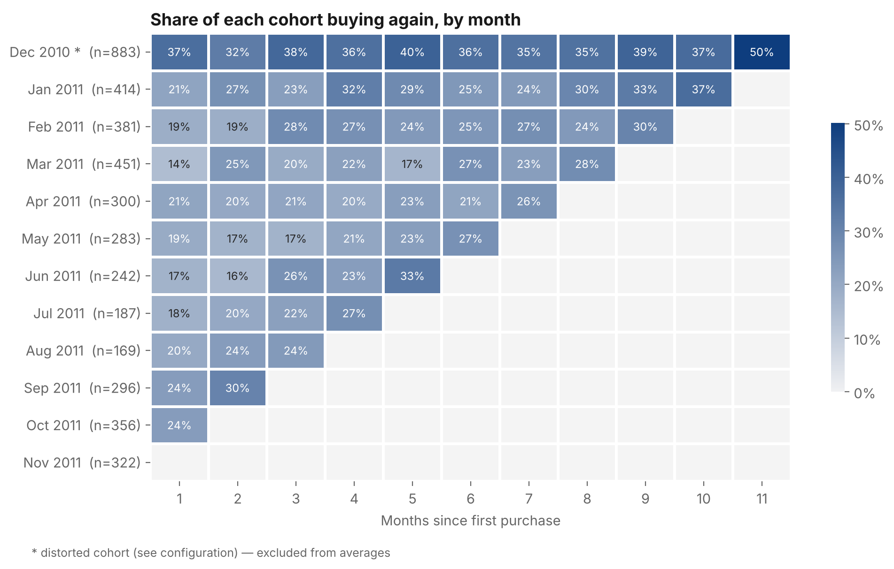
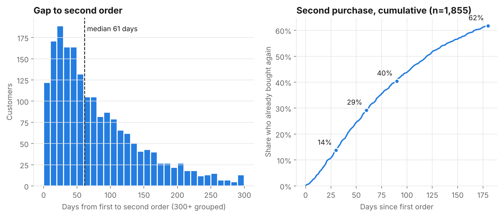
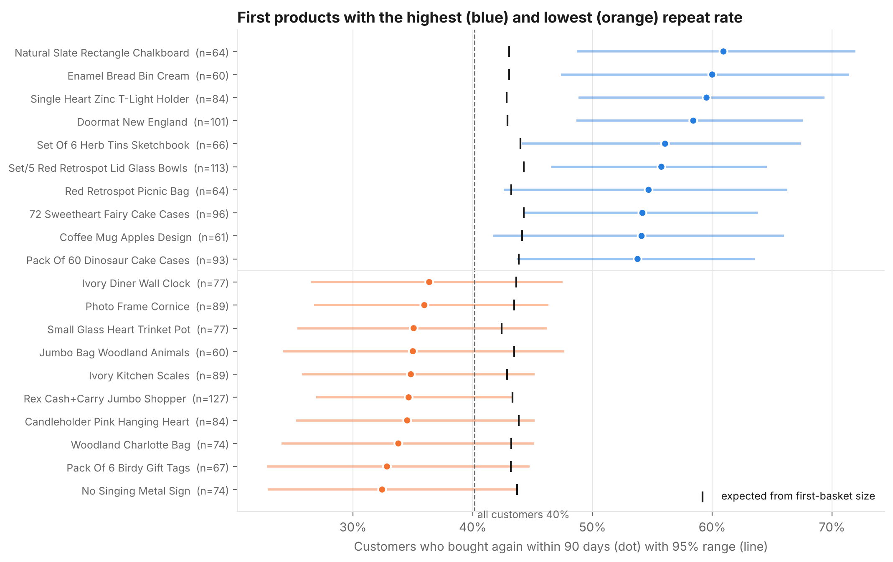
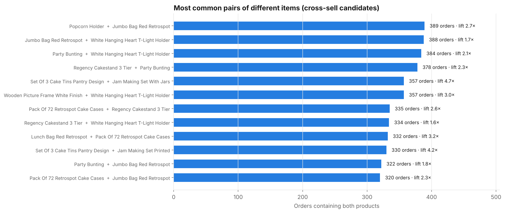

# E-commerce cohort & repeat-purchase analysis

**Question:** do first-time buyers come back, how fast, after which first product, and where does the store lose them?

**Data:** 12 months of real order lines from an online gift retailer (UCI *Online Retail*, Dec 2010 – Nov 2011):
541,909 lines → **18,837 valid orders**, **4,284 trackable customers**.
**Stack:** Python, pandas, matplotlib, seaborn. One notebook you can rerun on new exports.

| Deliverable | File |
|---|---|
| Rerunnable notebook with plain-language notes | [`cohort_retention_analysis.ipynb`](cohort_retention_analysis.ipynb) |
| Presentation charts (PNG, 200 dpi) | [`charts/`](charts) |
| Tables behind every chart (CSV) | [`outputs/`](outputs) |

---

## One-page summary

### Key numbers

| | |
|---|---|
| Customers who never buy a second time | **44%** |
| Second purchase within 90 days | **40%** |
| Median time from first to second order | **61 days** (middle half: 29–116) |
| Share of a typical cohort buying in month 1 / 3 / 6 | **19% / 22% / 25%** |
| Guest orders that can't be tracked | 1,331 (7.1% of orders, 15% of revenue) |

### Findings

1. **People are lost at the second purchase, not later.** 44% of customers buy once and never come back.
   After that the curve doesn't decay: about 1 in 5 of a cohort buys in any given month, and that holds for at least 6 months.
   The biggest lever is turning first-time buyers into second-time buyers.

   

2. **The window for the second order is days 30–90.** Only 14% come back within 30 days, 40% within 90, and 62% within 180.
   A reminder or offer around day 30–45 catches people before the median return (day 61), not after.

   

3. **The size of the first order predicts more than the product in it.** Customers whose first order has 1 product repeat at 24%,
   and those with 26+ products at 46%. So a product that usually sits in big orders looks "sticky" for the wrong reason.

4. **A few first products do beat that expectation.** After adjusting for first-basket size, 10 of 195 products are clearly above it:
   for example, slate chalkboards, enamel bread bin, zinc T-light holder and doormats (58–61% vs ~43% expected).
   One is clearly below: the Rex Cash+Carry jumbo shopper (35% vs 43%). With 195 products tested, about 5 per side would pass
   by chance, so treat this as a **shortlist to test** (e.g. as entry offers), not a verdict.

   

5. **Customers buy collections.** 96% of the 100 most common pairs are the same item in another design or from the same product line
   (lunch bags in different prints, the "Regency" teacup + cake stand). This makes the case for mixed-design multipacks.
   Among different items, the strongest links are matching tableware (bowl + cup in the same pattern, ~30× more often than chance)
   and baking sets (cake tins + jam-making set, ~5×).

   

6. **One unusual month can inflate the headline.** The first month of data (Dec 2010) mixes new customers with long-time ones:
   its month-1 retention is 37%, against 19% for a typical cohort. It is flagged and kept out of the averages. Promo months in a
   real store need the same treatment, and the notebook does this through one setting.

### Method in plain words

- **Cohort** = all customers whose first valid order fell in the same calendar month.
- **Repeat customer** = a second order on a **later day**. Two checkouts on the same day count as one occasion.
- **Fair comparison:** "repeat within 90 days" uses only customers we could watch for 90 days, so recent customers don't drag the rate down.
- **Excluded:** cancellation documents and the original lines they fully cancel (matched on customer + product + quantity),
  postage, fees and samples, zero-price lines, and the incomplete last month. Every step is counted in `outputs/cleaning_steps.csv`.
- **Uncertainty:** each product rate has a 95% range. Medians are used instead of averages where a few extreme customers would distort the number.

### Caveats

- The retailer sells largely to small shops, so absolute repeat rates are higher than for a typical direct-to-consumer brand. The method transfers; the levels don't.
- Activity rises in autumn: about 950 active customers a month in summer against 1,660 in November. Part of the month 4–6 "retention" is the pre-Christmas season.
- Only 27% of cancellation lines could be matched to their original purchase. The rest are partial returns or refer to orders before the data starts.
- Products are grouped into "families" by matching words in their names. This is a heuristic; a product catalogue with categories would be better.

---

## Rerun on your own exports

```bash
pip install -r requirements.txt
# put one or more CSV exports into data/raw/  (Shopify column names are recognised)
jupyter nbconvert --to notebook --execute --inplace cohort_retention_analysis.ipynb
```

The *Configuration* cell holds every business rule: column-name aliases, discount codes to exclude (e.g. `STAFF`),
refund statuses, promo/distorted months, the repeat window and the minimum sample per product.
If `data/raw/` is empty, the public sample dataset is downloaded automatically.

*Data: Daqing Chen, Online Retail dataset, UCI Machine Learning Repository (CC BY 4.0).*
